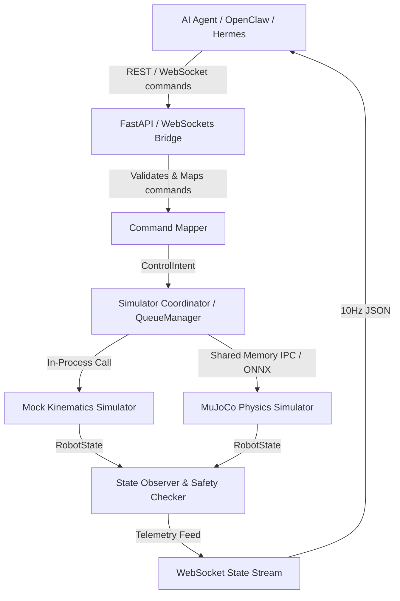

<!-- generated-by: gsd-doc-writer -->
# System Architecture

This document describes the high-level system architecture, component layout, data flow, and core abstractions of the Duck Agent Simulation MVP.

---

## 1. System Overview

The Duck Agent Simulation MVP is designed as a modular, layered API Bridge that decouples high-level AI agent decision-making from low-level robotics controller physics. The system acts as a translator: it ingests structured high-level motion intents (like `walk_forward` or `turn_left`) from external AI agents via REST or WebSocket connections, performs automated preflight safety validation, and maps these commands to target velocities. These velocities are then executed by either a lightweight, deterministic kinematic **Mock Simulator** or a full **MuJoCo Physics Simulator** utilizing a trained deep reinforcement learning (ONNX) locomotion policy. Physical states are monitored at 10Hz and broadcasted back to the agents in real-time, completing a closed-loop control system.

---

## 2. Component Diagram

The following Mermaid diagram visualizes the primary components and data flows within the system:



---

## 3. Data Flow

When an AI agent commands the robot, the data moves through the following sequence:

1. **Ingestion & Preflight Safety Check**: The agent issues a POST request to `/command` or sends a WebSocket frame to `/ws`. The FastAPI handler intercepts the command and triggers `evaluate_stability()`. If the robot is determined to be unstable or fallen, a preflight recovery sequence (stop followed by reset) is executed, and the new command is aborted.
2. **Command Queueing**: The accepted command is submitted to the `QueueManager` to execute asynchronously on the active simulator.
3. **Velocity Mapping & Execution**: The command is translated into linear and angular target velocities by the `CommandMapper`. 
   - In **Mock Mode**, the waddling kinematics are simulated within the bridge process.
   - In **Real Mode**, target velocities are passed to the ONNX locomotion policy, which calculates the 50Hz joint angle actions executed within the MuJoCo passive physics loop.
4. **State Observation**: The `StateEstimator` reads sensor data (IMU, contacts) to calculate the absolute XYZ position, Euler roll/pitch/yaw angles, and foot contacts.
5. **Post-Command Safety Audit**: After the command's duration expires, a post-command safety check runs. If stability bounds have been breached (e.g. excessive tilt), the robot is immediately stopped and reset.
6. **Telemetry Broadcast**: The updated robot state is published to the `SharedTelemetryBus` and broadcasted to all connected WebSocket clients at a constant 10Hz frequency.

---

## 4. Key Abstractions

The system enforces modularity using several core abstractions:

- **[DuckSimulator](duck_agent_sim/simulator/duck_sim.py)**: The abstract base class defining the contract for all simulator backends (e.g. `get_state()`, `apply_command()`, `reset()`, `stop()`).
- **[MockDuckSimulator](duck_agent_sim/simulator/duck_sim.py)**: A deterministic, physics-free simulator backend implementing waddling and leg contact kinematics.
- **[RealDuckSimulator](duck_agent_sim/simulator/duck_sim.py)**: The physics-based simulator backend that loads the XML terrains, runs the passive MuJoCo viewer, and executes the gait control ONNX policy.
- **[SimulatorProxy](duck_agent_sim/services.py)**: A transparent proxy for the active simulator singleton, ensuring backward compatibility for legacy imports while allowing runtime dependency injection.
- **[QueueManager](duck_agent_sim/simulator/queue_manager.py)**: Manages command execution queues, ensuring thread-safe asynchronous execution of movements.
- **[AppContext](duck_agent_sim/services.py)**: The central application context and registry that manages the lifecycle (startup/shutdown) and dependency injection graph of all services.
- **[evaluate_stability](duck_agent_sim/simulator/safety.py)**: The unified safety rules engine evaluating if the robot has fallen or tilted past configured thresholds.

---

## 5. Directory Structure Rationale

The project is structured to isolate specific functional concerns and support future scalability:

```text
duck_sim/
├── docs/                       # Design specifications, logs, and reports
├── duck_agent_sim/             # Core Python package
│   ├── agent/                  # Agent client wrappers, adapters, and scripted routines
│   ├── bridge/                 # REST API endpoints and WebSocket telemetry routes
│   ├── hardware/               # Hardware abstraction layers and servo driver interfaces
│   ├── models/                 # Neural network models (ONNX) and local assets
│   ├── runtime/                # Real-time telemetry buses and multi-process IPC utils
│   ├── scenarios/              # Pre-scripted path and safety scenarios
│   ├── simulator/              # Simulator backends, state estimators, and safety logic
│   └── vision/                 # YOLO detectors, frame buffers, and target trackers
├── external/                   # Git submodules (e.g., Open_Duck_Playground)
├── scripts/                    # Runner and helper shell scripts
└── tests/                      # Extensive pytest suite validating API, safety, and models
```
